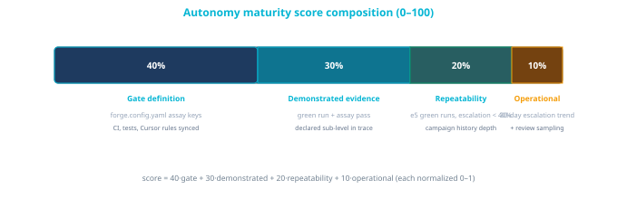

# Autonomy maturity framework

**Purpose:** turn the [autonomy ladder](AUTONOMY-LEVELS.md) into a **per-project assessment**: given a repository's observable signals, report the **observed level and grade**, a **0–100 maturity score**, and **actionable recommendations** for the next promotion. This page is the canonical scoring spec; the reference implementation is the **Autonomy maturity** panel in Forge Lenses Studio.

The assessment is **observed, not declared**: it reads repo and workspace signals, never Wizard session intent. Wizard autonomy settings express what an operator *wants* for one contribution; maturity describes what the project has *proven*. Cross-link the two in UI ("Wizard set to L2 Stage Autopilot; assessment observes L1b — here's the gap"), never merge them.

## Observed level and grade

```text
observed = highest (level, grade >= b) supported by deterministic signals
```

A project with no unattended-run evidence observes **L0a** — interactive-only, policy known. Grades follow the [promotion criteria](AUTONOMY-LEVELS.md#promotion-criteria-grade-transitions): **b** needs one green assay-passing run at that (sub-)level in this repo; **c** needs ≥5 with escalation rate < 40%; **d** needs a falling escalation trend plus review sampling.

## Score model (0–100)

```text
score = 40·gate_definition + 30·demonstrated_evidence + 20·repeatability + 10·operational_metrics
```

Each component is normalized 0–1 from deterministic checks:

| Component | Weight | What it measures | Deterministic signals |
|-----------|--------|------------------|-----------------------|
| **gate_definition** | 40 | Are the gates in place at all? | `forge/forge.config.yaml` present with assay keys (`tests_pass`, `acceptance_criteria_met`, `risks_reviewed`); Forge Cursor rules synced; CI config present; test suite present |
| **demonstrated_evidence** | 30 | Has any (sub-)level gone green here? | Dark Factory trace / campaign run records with declared level or sub-level and `final_status: pass`; assay pass recorded |
| **repeatability** | 20 | Does it keep going green? | ≥5 green runs at the same (sub-)level; campaign history depth; escalation rate < 40% across those runs |
| **operational_metrics** | 10 | Is it the default mode? | Escalation-rate metric recorded and trending down over 30 days; review-sampling record present |

Supporting signals may raise component confidence but never substitute for run evidence: a Docs Health score, standards-compliance checks, and branch-protection hints inform **gate_definition** only.



## Recommendations

Every failed or partial check emits one **recommendation string** — concrete, ordered by score impact, phrased as the next action:

- "Add `forge/forge.config.yaml` with the three core assay keys to unlock gate scoring."
- "No unattended runs recorded — run one L1.1 campaign item against a provided failing test to earn L1.1b."
- "L2.2 demonstrated once; 4 more green runs at < 40% escalation promote it to L2.2c."

Recommendations always target the **cheapest next promotion**, not the highest level — the ladder is climbed one grade at a time.

## Anti-gaming stance

Scores inherit the assay hardening rules: file-count and name-matching proxies do not count as evidence where a sub-level defines stronger checks (pre-existing failing test for L2.2, registered E2E runner allowlist for L3.x). A score computed from gameable evidence is a defect in the assessor, not a maturity gain.

## Consumers

| Consumer | Surface |
|----------|---------|
| **Forge Lenses Studio** | Autonomy maturity panel — workspace table (score per project, weakest first) + per-project detail (observed level+grade, gap checklist) |
| **Composer self-assessment** | Read-only prompt pack (`forge-platform/.cursor/composer/31-autonomy-maturity-selfassess.md`) applying this spec to one repo |
| **Campaign sizing** | Declared campaign (sub-)levels should not exceed observed grade + one promotion step |

## Related

- [Autonomy levels](AUTONOMY-LEVELS.md) — ladder, grades, sub-levels, promotion criteria
- [Bounded execution examples](BOUNDED-EXECUTION-EXAMPLES.md) — the run evidence this framework counts
- [Respecting resources](RESPECTING-RESOURCES.md) — escalation rate definition and operator table
- [Forge Platform autonomy levels](https://platform.forgesdlc.com/docs-autonomy-levels-index.html) — per-level reference architecture
