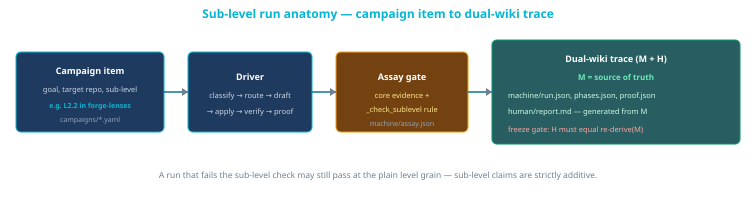

# Bounded execution examples

This page makes the [autonomy ladder](AUTONOMY-LEVELS.md) and [respecting resources](RESPECTING-RESOURCES.md) rules concrete. Every example below is drawn from a **real run** of the **Forge Dark Factory PoC** (the reference implementation), so you can see exactly what each level spends and where humans still gate.

Read this after the two reference pages: this page shows *how the rules behave in practice*, not new policy.

## The loop you are watching

Each example is one pass (or one campaign item) through the same sequential, human-gated loop:


*The loop spends the abundant (time, deterministic checks, local calls) before the scarce (tokens, review). Verify failures trigger bounded repair; ambiguity or budget exhaustion escalates to a human — who still approves the branch or merge.*

Sub-level claims add distinct assay evidence on top of the level's core gates:



*The driver produces machine records; the assay gate enforces `_check_sublevel` rules; Wiki M is canonical and Wiki H is derived with a freeze gate.*

Two ideas make the examples readable:

- **Routing tier** is the engine the router *selected* (deterministic, local, escalate).
- **Worker ladder** is what actually *ran* inside the draft step: `local (Granite) → cursor → deterministic → fake`. Stepping from Granite to Cursor is a **within-loop** move — it is **not** the same as loop **escalation** to a human.

## How to read each example

| Field | Meaning |
|-------|---------|
| **Autonomy level** | The declared ladder target for the run |
| **Sub-level (retro-tag)** | The [sub-level](AUTONOMY-LEVELS.md#sub-levels-l1l4-band) and [grade](AUTONOMY-LEVELS.md#maturity-grades-ad) assigned retrospectively — these runs predate the sub-level scheme, so tags reflect the closest evidence match |
| **Resources spent** | Tokens, local compute, and human attention actually consumed |
| **Human gate** | Where a person still decides |
| **Evidence** | Path pattern to the machine record and generated human report |

---

## Example 1 — L1 offline, zero tokens (deterministic fixture)

The cheapest possible run: a deterministic `fake` worker fixes a failing `multiply` test with **no model and no network**. This is the offline CI baseline.

| Aspect | Value |
|--------|-------|
| **Campaign item** | `poc-sandbox-offline` (`campaigns/poc-boundary.yaml`) |
| **Goal** | fix failing multiply |
| **Classification** | domain `complicated` · size `S` · value `high` · task_class `generic` |
| **Routing** | tier `local`; required `0.55`, expected `0.60`; decompose `false` |
| **Draft worker** | `fake` (fixture `sandbox/fixtures/multiply_fix.json`) |
| **Change** | 1 file — `calculator.py` |
| **Autonomy level** | **L1** — one function to a fixed signature |
| **Sub-level (retro-tag)** | **L1.1b** — provided failing test unchanged, turned green |
| **Resources spent** | 0 tokens, ~1 second wall-clock, no human turn |
| **Human gate** | Approve branch/merge (outside the PoC loop) |
| **Result** | `final_status: pass`, `escalated: false`, assay OK |

Phase trace (from the generated report):

```text
context - ok        3 items
plan - ok           pu-target-0; allowed=1
draft-unit - ok     fake; 1 file(s); fixture=.../multiply_fix.json
apply+verify - ok   changed=['calculator.py']
assay - ok          all core evidence present
```

**Teaching point:** when a deterministic fixture (or rule, script, or CI check) can settle the task, no LLM is invoked at all. Winner backend: `fake`.

*Evidence:* `runs/campaigns/poc-boundary/poc-sandbox-offline/run-*/{machine,human}/`

---

## Example 2 — L1 on a real target, with a worker-ladder step

Same L1 shape, but on a real docs fixture and with a live model. The router picks `local`, Granite stalls, and the **worker ladder steps to Cursor** — all *without* escalating the loop to a human.

| Aspect | Value |
|--------|-------|
| **Campaign item** | `L1-a-broken-link` (`campaigns/lenses-production.yaml`) |
| **Goal** | fix broken relative markdown link `./no-such-page.md` in `README.md` |
| **Classification** | domain `complicated` · size `S` · value `high` · task_class `tests` |
| **Routing** | tier `local`; required `0.55`, expected `0.60` |
| **Draft worker** | Granite stalled (`success 0.0`) → **Cursor** `composer-2.5` won (`reliability 1.0`) |
| **Change** | 1 file — `README.md` |
| **Autonomy level** | **L1** |
| **Sub-level (retro-tag)** | **L1.2b** — run carried its own verification alongside the fix (closest match; predates the scheme) |
| **Resources spent** | Local attempt + one Cursor draft; no human turn during the loop |
| **Human gate** | Approve branch/merge; **promotion refused** (live repo absent) |
| **Result** | `final_status: pass`, `escalated: false` |

Phase trace:

```text
context - ok        4 items
plan - ok           pu-target-0; allowed=2
draft-unit - ok     cursor; 1 file(s); model=composer-2.5
apply+verify - ok   changed=['README.md']
assay - ok          all core evidence present
promote - fail      live repo missing (promotion safely skipped)
```

**Teaching point:** the worker ladder (`local → cursor`) is how the loop *spends time before tokens* and recovers from a weak local draft without a human. `escalated: false` because no ambiguity/exhaustion forced a human decision. Promotion is a separate, guarded step — it **failed closed** because there was no clean live tree to write into.

*Evidence:* `runs/campaigns/lenses-production/L1-a-broken-link/run-*/{machine,human}/`

---

## Example 3 — L2 change-set across two files

L2 raises the unit of delivery to a **multi-file change-set** with no rearchitecture. The plan produces **two patch units**, applied and verified in sequence.

| Aspect | Value |
|--------|-------|
| **Campaign item** | `L2-broken-link-and-nested` (`campaigns/lenses-production-l2.yaml`) |
| **Goal** | fix README broken link **and** `nested.md` TODO placeholder |
| **Classification** | domain `complicated` · size `S` · value `high` · task_class `docs` |
| **Plan** | **2 patch units (L2)** |
| **Changes** | 2 files — `README.md`, `docs/guide/nested.md` |
| **Autonomy level** | **L2** — change-set, contracts and architecture fixed |
| **Sub-level (retro-tag)** | **L2.2b** — cross-file defect fix; note the pre-existing-failing-test evidence now required for new L2.2 claims was not recorded at the time |
| **Human gate** | Accept acceptance criteria **+** merge |
| **Result** | `final_status: pass`, both units `pass` |

Phase trace:

```text
plan - ok             2 patch units (L2)
draft-unit-0 - ok     cursor; 1 file(s); model=composer-2.5
apply+verify - ok     changed=['README.md']
draft-unit-1 - ok     cursor; 1 file(s); model=composer-2.5
apply+verify - ok     changed=['docs/guide/nested.md']
assay - ok            all core evidence present
```

### L1 vs L2 at a glance

| | **L1 (Example 2)** | **L2 (Example 3)** |
|--|--------------------|--------------------|
| Unit of delivery | One function / contract-bound change | Multi-file change-set |
| Patch units | 1 | 2 (ordered) |
| Files changed | 1 | ≥ 2 distinct |
| Assay requirement | Core evidence present | Core evidence **+ ≥2 distinct changed files** |
| Stays fixed | Architecture, API, tests | Architecture, public contracts |
| Human gate | Approve merge | Accept AC + merge |

**Teaching point:** L2 is *not* "a bigger L1." The Assay gate for L2 verifies the proof union contains **two or more distinct files** — a single-file patch cannot masquerade as a change-set. Only the **final** patch unit runs the item's `verification_argv`.

*Evidence:* `runs/campaigns/lenses-production-l2/L2-broken-link-and-nested/run-*/{machine,human}/`

---

## Example 4 — What "done" means (PDCA Check gates)

Autonomy without gates is just fast breakage. Campaigns wrap the loop in **Plan → Do → Check → Act**, and "done" is defined by the Check gates.


*One item at a time, worktree-isolated. On a Check failure, Act steps to the next worker tier once; promotion needs a clean live tree and is never auto-committed.*

**Check gates (all must pass):**

1. **Dual-wiki freeze gate** — the human report matches the machine record (see Example 5).
2. **Assay gate** — `forge/forge.config.yaml` core evidence: `tests_pass`, `acceptance_criteria_met`, `risks_reviewed`.
3. **Driver `final_status == pass`**.
4. **Optional `verification_argv`** — pytest, a link checker, or inline asserts on the final unit.

**Promotion policy:** even when every gate is green, changes are copied worktree → live **only** if `git status --porcelain` is clean, and there is **no auto-commit** — the operator commits manually. If the tree is dirty, promotion is skipped and recorded in `promote.json` (this is exactly what "promote - fail" meant in Example 2).

**Teaching point:** the human gate does not disappear at higher throughput — it moves to a clear, evidenced decision point.

---

## Example 5 — Auditability without drift (dual-wiki trace)

Every run documents itself on two synchronized surfaces so a human can back-trace decisions.


*Machine records are the source of truth; the human report is generated from them. A freeze gate re-derives the narrative and fails on any mismatch.*

| | Wiki M (machine canonical) | Wiki H (human narrative) |
|-|----------------------------|--------------------------|
| Form | JSON under `runs/<run_id>/machine/` | Markdown at `runs/<run_id>/human/report.md` |
| Truth | Source of truth | Derived from M |
| Audience | Driver + tools | Human steering / auditing |

**Teaching point:** the reports you read in Examples 1–3 are **generated**, never hand-written. The freeze gate guarantees the story can never silently drift from what actually happened. The rule is blunt: **never hand-edit `report.md`** — change the machine records or the generator, then regenerate.

---

## Example 6 — When the loop should stop (escalation and honesty)

Escalation is a feature, not a failure. The router is deterministic about *when* to spend scarce resources instead of pretending a small local model can do everything.


*Default when local quality is marginal: decompose (spend free time), not escalate (spend scarce tokens).*

| Scenario | Classification | What the router does | Why |
|----------|----------------|----------------------|-----|
| Rename a symbol with a codemod rule | clear · S | **deterministic** (cost 0) | A rule exists; no LLM needed |
| Fix a localized failing test | complicated · S | **local**, worker ladder to Cursor if it stalls | Small-model sweet spot (Examples 1–2) |
| Large refactor request | complicated · XL | **decompose** before any cloud call | `size > S`: smaller units fit local; time is free |
| Design a new module boundary | architecture | **escalate** to human | `required_quality` set artificially high for architecture/security |
| Security-sensitive change | security | **escalate** to human | Same honesty stance — never routed to a small model |
| Granite exceeds the 45s timeout | any | skip further `local`, step to **Cursor** | Fail-fast; then loop-escalate only if still stalled |

**Cloud escalation is gated:** it requires `value == must_have` **and** `local_stalled` **and** `decomposition_exhausted`. Track **escalation rate** over time — a rising rate signals weak scaffolds or mis-sized autonomy, not "smarter" automation.

**Teaching point:** the honest local-first posture is *local-first with ROI-gated escalation*. Fully cloud-free autonomy above L1 is not realistic on a ~4GB profile — planning, architecture, and ambiguity exceed small-model capability. See [resource honesty](AUTONOMY-LEVELS.md#resource-honesty-local-first).

---

## Example 7 — L3 use-case slice across logic, docs, and UI

L3 raises the unit of delivery to an **end-to-end user-visible flow** inside one existing app. The plan produces **three patch units** across distinct layers, and Assay requires cross-layer and E2E evidence.

| Aspect | Value |
|--------|-------|
| **Campaign item** | `L3-ui-smoke` / `L3-scan-flow` (`campaigns/lenses-production-l3-ci.yaml`) |
| **Goal** | Playwright E2E scan flow shows Scan finished banner after use-case fix |
| **Classification** | domain `complicated` · size `M` · value `high` · task_class `docs` |
| **Plan** | **3 patch units (L3)** — layers: `logic`, `docs`, `ui` |
| **Changes** | 3 files — `app/scanner.py`, `README.md`, `ui/index.html` |
| **Autonomy level** | **L3** — use-case slice, architecture fixed |
| **Sub-level (retro-tag)** | **L3.1b** — sandbox app slice with registered E2E verification |
| **E2E** | `scripts/verify-docs-health-l3.py` |
| **Human gate** | Intent + acceptance in; review out |
| **Result** | `final_status: pass`, `escalated: false` |

Phase trace:

```text
plan - ok             3 patch units (L3)
draft-unit-0 - ok     deterministic; app/scanner.py (logic)
draft-unit-1 - ok     deterministic; README.md (docs)
draft-unit-2 - ok     deterministic; ui/index.html (ui)
assay - ok            all core evidence present
```

Like Examples 1–3, the human `report.md` is **generated** from machine records under `runs/.../machine/` — see [Example 5 — dual-wiki trace](#example-5--auditability-without-drift-dual-wiki-trace). Do not hand-edit the narrative; regenerate from machine JSON if the story drifts.

### L2 vs L3 at a glance

| | **L2 (Example 3)** | **L3 (Example 7)** |
|--|--------------------|--------------------|
| Unit of delivery | Multi-file change-set | End-to-end use-case slice |
| Layers | Same kind of change (docs) | logic + docs + ui |
| File types | Any ≥2 distinct files | `.py` **and** non-`.py` required |
| E2E | Optional `verification_argv` | E2E / Playwright recorded in `tests_run` |
| Human gate | Accept AC + merge | Intent in; review out |

**Teaching point:** L3 Assay verifies **≥2 distinct layers**, **both** `.py` and non-`.py` files in the proof union, and **E2E pass** in `tests_run` — a multi-file docs-only patch cannot masquerade as a use-case slice.

*Evidence:* `runs/campaigns/lenses-production-l3-ci/L3-ui-smoke/run-*/{machine,human}/`

---

## Example 8 — L2.1 mechanical multi-file (hypothetical, worked-through)

**Hypothetical case** — no matching campaign run exists today; this narrative shows what an L2.1 pass would look like and how `_check_sublevel` would enforce it.

A codemod-style rename across two Python modules: the plan applies the same-shaped hunk (one added line, one removed line per file) to `utils/helpers.py` and `utils/compat.py` without touching any test files.

| Aspect | Value |
|--------|-------|
| **Campaign item** | `lenses-rename-alias` (hypothetical; not in `campaigns/`) |
| **Goal** | rename internal alias `legacy_id` → `record_id` in two helper modules |
| **Classification** | domain `complicated` · size `S` · task_class `refactor` |
| **Plan** | **2 patch units (L2.1)** — same hunk shape per file |
| **Changes** | 2 files — `utils/helpers.py`, `utils/compat.py` (no test files) |
| **Autonomy level** | **L2** — mechanical change-set |
| **Sub-level** | **L2.1** — mechanical multi-file |
| **Hunk shapes** | `(1, 1)` on both files — identical added/removed signature |
| **Human gate** | Accept AC + merge |
| **Assay pass rationale** | `_check_sublevel` for L2.1: `hunk_shapes` has ≥2 entries with identical tuple; no `_is_test_file` in `changed_files` |
| **Assay fail example** | If `tests/test_helpers.py` were in the diff → `L2.1 evidence: behavior-test delta present` |

**Teaching point:** L2.1 is for mechanical, same-shaped edits across files — not defect fixes (L2.2) and not behavior changes with new tests (L2.3). A rename that accidentally edits a test file fails the L2.1 sub-level check even if L2 core evidence (≥2 files) passes.

*Evidence pattern (if run):* `runs/campaigns/<campaign>/<item>/run-*/{machine,human}/` with `machine/assay.json` recording `sublevel: L2.1` and `hunk_shapes`.

---

## Example 9 — L3.2 production-repo slice (hypothetical, worked-through)

**Hypothetical case** — no matching campaign run exists today; this narrative extends Example 7's L3.1 sandbox slice to a production repo on a branch.

The same three-layer slice (logic + docs + UI) runs against `forge-lenses` on a feature branch instead of the sandbox app. All L3.1 evidence holds, but `target_repo` is outside the sandbox allowlist.

| Aspect | Value |
|--------|-------|
| **Campaign item** | `lenses-scan-flow-production` (hypothetical; not in `campaigns/`) |
| **Goal** | E2E scan flow green in production repo on branch `feat/scan-banner` |
| **Classification** | domain `complicated` · size `M` · value `high` |
| **Plan** | **3 patch units (L3.2)** — layers: `logic`, `docs`, `ui` |
| **Changes** | 3 files — `lenses/scanner.py`, `README.md`, `ui/index.html` |
| **Target repo** | `forge-lenses` (not in sandbox allowlist) |
| **Autonomy level** | **L3** — use-case slice |
| **Sub-level** | **L3.2** — production-repo slice |
| **E2E** | `scripts/verify-docs-health-l3.py` (registered runner) |
| **Human gate** | Intent + acceptance in; review out |
| **Assay pass rationale** | L3 core: ≥2 layers, `.py` + non-`.py`, E2E in allowlist. L3.2: `target_repo` declared and `_is_sandbox(target_repo)` is false |
| **Assay fail example** | Same slice against `sandbox/app` → `L3.2 evidence: target repo is in the sandbox allowlist` |

**Teaching point:** L3.2 inherits all L3.1 checks and adds the production-repo boundary. A sandbox slice cannot claim L3.2 even with identical file patterns — the assay reads `target_repo` against the sandbox allowlist.

*Evidence pattern (if run):* `runs/campaigns/<campaign>/<item>/run-*/{machine,human}/` with `machine/run.json` declaring `target_repo: forge-lenses` and `sublevel: L3.2`.

---

## What these examples do not show

- **Unsupervised push/deploy** — every example stops at a human-gated branch/merge or a guarded promotion; nothing ships without a person.
- **L4+ autonomy** — feature, subsystem, product, and multi-platform levels remain vision requiring ADRs, go/no-go, and strategic checkpoints.

## Related

- [Autonomy levels](AUTONOMY-LEVELS.md) — L0–L8 ladder, Assay enforcement, 4GB honesty
- [Forge Platform autonomy levels](https://platform.forgesdlc.com/docs-autonomy-levels-index.html) — per-level reference architecture and readiness matrix
- [Respecting resources](RESPECTING-RESOURCES.md) — scarce vs abundant, decompose-before-escalate
- [Cost-aware planning and model tiering](COST-AWARE-PLANNING-AND-MODEL-TIERING.md) — the interactive Cursor counterpart
- [Agentic SDLC](../agentic-sdlc.md) — humans own intent; agents amplify execution
